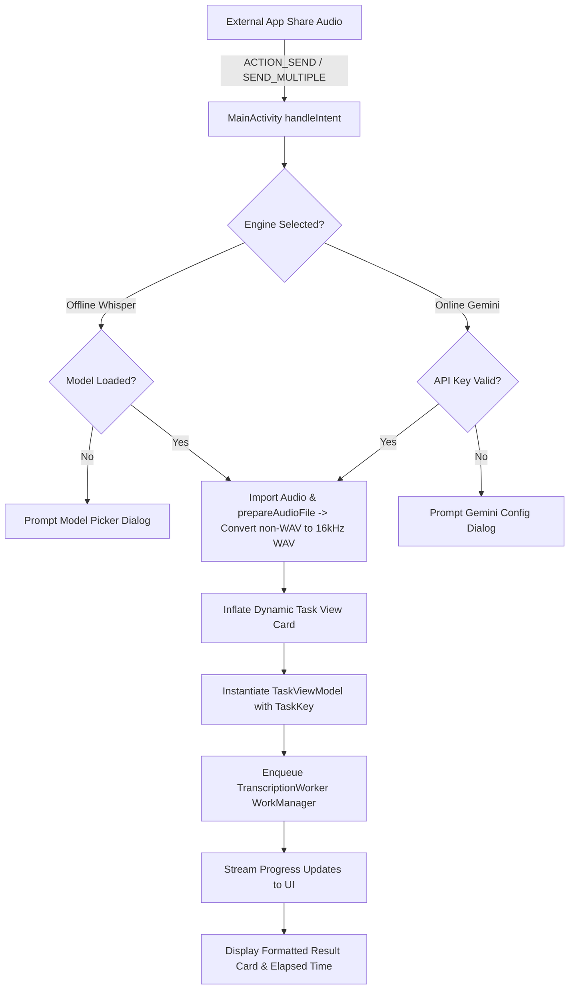
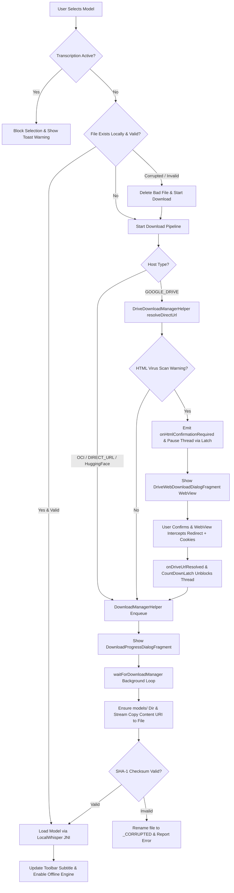
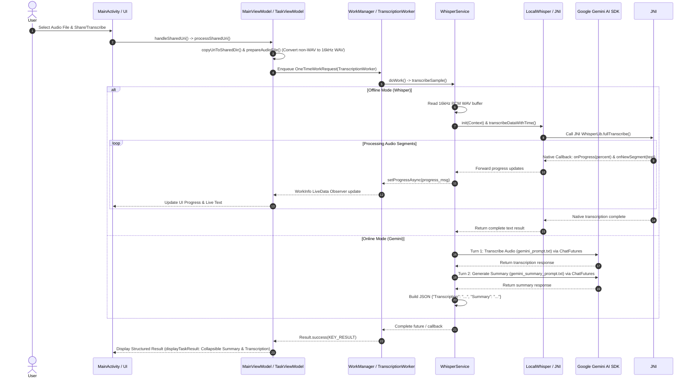

# Software Architecture Document
**Project Name:** wait for Beep! (Beep)  
**Package:** `il.co.bensavit.beep`  
**Target Platform:** Android (minSdkVersion 26, targetSdkVersion 36)  

---

## 1. Executive Summary & Project Overview

**"wait for Beep!"** is a high-performance Android application designed for speech-to-text audio transcription and voice processing. The project adopts a **Hybrid AI Architecture** combining **offline, zero-latency local speech recognition** via native C++ Whisper (GGML engine) with **cloud-based generative AI transcription** via the Google Gemini AI SDK.

### Key Value Propositions
* **Privacy & Offline First:** Local transcription powered by `whisper.cpp` native binaries runs completely on-device without internet access or data transmission.
* **Hybrid Processing:** Users can seamlessly toggle between lightweight/medium local models (GGML binaries) and Google Gemini AI cloud models depending on connectivity and accuracy requirements.
* **Hardware Acceleration:** Native C++ JNI bridge dynamically selects CPU SIMD-optimized binaries (`ARM64 FP16`, `ARMv7 VFPv4/NEON`, `x86_64`) based on runtime CPU feature detection.
* **Seamless System Integration:** Supports intent filters (`android.intent.action.SEND` / `SEND_MULTIPLE`) for audio files shared from external apps (`audio/*` and `application/octet-stream` MIME types), in-app audio recording from device microphone, background execution resilience via Android `WorkManager`, and in-app software updates via Google Play App Update API (`InAppUpdateManager`).

---

## 2. Logical Partitioning & Architectural Layers

The codebase follows a modular **Model-View-ViewModel (MVVM)** pattern combined with a **Service/Repository** architecture. The application is logically partitioned into four distinct layers:

```mermaid
graph TD
    subgraph Application Host Layer
        APP[App Application]
    end

    subgraph Layer 1: Presentation & UI Layer
        MA[MainActivity]
        MVM[MainViewModel]
        TTVM[TranscriptionTaskViewModel]
        UID[Dialogs & UI Components<br/>HistoryFilePicker, ModelPickerAndDownloader]
        UM[InAppUpdateManager]
    end

    subgraph Layer 2: Service & Execution Layer
        WS[WhisperService Singleton]
        LW[LocalWhisper Singleton]
        TW[TranscriptionWorker WorkManager]
        CW[CleanupWorker WorkManager]
    end

    subgraph Layer 3: Native C++ & JNI Bridge Layer
        WL[WhisperLib JNI Wrapper]
        WC[WhisperContext]
        JN[jni.c C Bridge]
        GGML[Whisper-Core C/C++ Engine<br/>GGML SIMD / NEON / FP16]
    end

    subgraph Layer 4: Data, Storage & Utility Layer
        MR[ModelRepository]
        SM[SettingsManager & EncryptedPrefs]
        AC[AudioConverter / MediaCodec]
        WE[WaveEncoder]
        DMH[DownloadManagerHelper<br/>Direct URLs / Hugging Face]
        DU[DriveDownloadManagerHelper<br/>Google Drive Files]
        LOG[Logger & LogBuffer]
        MU[ModelUtils]
    end

    subgraph External Services
        GEM[Google Gemini AI SDK]
        PLAY[Google Play App Update API]
    end

    %% Flow interactions
    APP --> MA
    APP --> CW
    APP --> SM
    APP --> MR
    MA --> MVM
    MA --> TTVM
    MA --> UID
    MA --> UM
    UM --> PLAY
    MVM --> WS
    MVM --> MR
    MVM --> SM
    TTVM --> TW
    TW --> WS
    WS -->|Offline Mode| LW
    WS -->|Cloud Mode| GEM
    LW --> WC
    WC --> WL
    WL --> JN
    JN --> GGML
    WS --> AC
    AC --> WE
    MR --> DMH
    MR --> DU
    MR --> MU
```

---

### Layer 1: Presentation & UI Layer (`il.co.bensavit.beep.ui`, `MainActivity`)

Responsible for handling user interactions, rendering system state, managing theme animations, and binding data streams to UI elements.

* **[MainActivity](file:///D:/Android/Projects/Beep/app/src/main/java/il/co/bensavit/beep/MainActivity.java)**:
  * Single Activity layout host utilizing `ActivityMainBinding` (ViewBinding).
  * Handles incoming share intents (`SEND`, `SEND_MULTIPLE` with `audio/*` and `application/octet-stream` MIME types).
  * Integrates `InAppUpdateManager` to perform flexible in-app software updates via Google Play (silent check on startup/resume, and manual update trigger).
  * Hosts toolbar menu actions (Select Audio Language, Model Downloader, Log Window, Gemini Configuration, Check for Updates, About, Record Audio).
  * Orchestrates interactive user onboarding prompts via `MaterialTapTargetPrompt`.
* **[MainViewModel](file:///D:/Android/Projects/Beep/app/src/main/java/il/co/bensavit/beep/MainViewModel.java)**:
  * Application-scoped ViewModel providing `LiveData` for UI state (`isProgressVisible`, `isGeminiSelected`, `currentModelName`, `downloadProgress`, `userMessage`).
  * Manages audio file conversion and preparation pipelines (`prepareAudioFile`), standardizing all incoming non-WAV audio files to 16kHz mono WAV format using `AudioConverter` and `WaveEncoder` prior to task dispatching for both Gemini and Whisper engines.
  * Maintains `activeTaskEntries` (`List<TaskEntry>`), tracking active transcription task handles (`file`, `taskKey`, `status`, `resultText`, `workId`, `elapsedTimeMs`, `isSummaryExpanded`, `isTranscriptionExpanded`) across Activity configuration changes and persisting task states to `EncryptedSharedPreferences` (`PREFS_NAME_TASKS_SECURE` / `beep_tasks_secure`) with automatic migration from legacy unencrypted SharedPreferences (`beep_tasks`).
  * Exposes `getTaskEntry(taskKey)` and `updateTaskExpandState()` to manage and persist collapsible view section preferences for task cards.
* **[TranscriptionTaskViewModel](file:///D:/Android/Projects/Beep/app/src/main/java/il/co/bensavit/beep/TranscriptionTaskViewModel.java)**:
  * Dedicated Task ViewModel managing the state, progress messages, and execution lifecycle of an active transcription job enqueued via `WorkManager`.
* **Modular UI Components & Dialogs**:
  * **[HistoryFilePicker](file:///D:/Android/Projects/Beep/app/src/main/java/il/co/bensavit/beep/ui/HistoryFilePicker.java)**: Bottom sheet / dialog for managing and selecting previously processed audio files.
  * **[ModelPickerAndDownloader](file:///D:/Android/Projects/Beep/app/src/main/java/il/co/bensavit/beep/ui/ModelPickerAndDownloader.java)**: Custom Material dialog displaying available remote models alongside local status badges via `ModelDownloadListAdapter`. Includes a neutral action button for quick access to Gemini API configuration and language-model conflict checking (`ModelUtils.isLanguageConflicting`) to warn users when an English-only model (`.en`) is selected with a non-English target language.
  * **[ModelDownloadListAdapter](file:///D:/Android/Projects/Beep/app/src/main/java/il/co/bensavit/beep/ui/ModelDownloadListAdapter.java)**: Specialized list adapter rendering model state badges (`Ready` with formatted file size, `Download Required`, `Corrupted` error status, or `Coming Soon`) and inline delete buttons for locally cached model binaries.
  * **Dialog Fragments & Pickers**:
    * `Language Selection Dialog (showLanguagePickerDialog)`: Single-choice `MaterialAlertDialog` mapping human-readable languages from `@array/languages` to ISO language codes (`auto`, `en`, `he`, `es`, etc.) from `@array/language_codes`. Updates `SettingsManager.setLanguage(code)` and `MainViewModel.language`.
    * `AboutDialogFragment`: App version, JNI/GGML/Gemini architecture highlights, live CodeQL Security Badge (`https://github.com/cue12/Beep/actions/workflows/codeql.yml`), Google Play Store feedback / feature request link (`request_feature`), manual update check action button (`checkForUpdatesManually()`), and scrollable third-party `NOTICE.txt` license viewer.
    * `LogWindowDialogFragment`: Real-time system log viewer with clipboard copy and log clearing capabilities.
    * `AudioRecordDialogFragment`: Embedded high-quality audio recording interface using `MediaRecorder`.
    * `GeminiConfigDialogFragment`: Gemini API key entry and model configuration interface.
    * `DownloadProgressDialogFragment`: Progress modal observing `MainViewModel.downloadProgress` (0-100%) and rendering a `LinearProgressIndicator` with download cancellation controls.
    * `DriveWebDownloadDialogFragment`: Embedded JavaScript- and cookie-enabled `WebView` modal used for resolving Google Drive anti-virus warning pages. Captures HTTP session cookies (`CookieManager`) and dispatches direct download links to `MainViewModel.onDriveUrlResolved()`.
  * **Visual Customizations**: Custom animated drawables (`ShimmerDrawable`, `BackdropDrawable`, `BackgroundAnimator`).

---

### Layer 2: Service & Execution Domain Layer (`il.co.bensavit.beep.services`, `workers`, `single`)

Acts as the operational core, routing requests between offline C++ inference and online Gemini cloud services, managing native model lifecycles, and scheduling background jobs.

* **[WhisperService](file:///D:/Android/Projects/Beep/app/src/main/java/il/co/bensavit/beep/services/WhisperService.java)** (Singleton):
  * Central engine router. Accepts audio input files and routes requests to either `LocalWhisper` or Google Gemini AI (`GenerativeModelFutures` & `ChatFutures`).
  * Supports Gemini **Auto Mode** (`"auto"` default), dynamically fetching available online models from `https://generativelanguage.googleapis.com/v1beta/models` (`fetchGeminiModels`), filtering `generateContent` models, caching them (`cachedGeminiModels`), and prioritizing flash models (`gemini-3.5-flash`, `gemini-3.5-flash-lite`, etc.) with automatic fallback if availability checks fail.
  * Executes multi-turn Gemini chat workflows: **Turn 1** transcribes audio with speaker identification (`gemini_prompt.txt`); **Turn 2** requests summarization (`gemini_summary_prompt.txt`). Returns a structured JSON payload (`{"Transcription": "...", "Summary": "..."}`).
  * Handles Gemini 404/retired model errors with structured user-friendly notifications.
  * Emits status and progress updates via `TranscriptionCallback`.
  * Exposes `release(boolean unloadNativeModel)` overload allowing clearing active task handlers without unloading the C++ native model from RAM.
* **[LocalWhisper](file:///D:/Android/Projects/Beep/app/src/main/java/il/co/bensavit/beep/single/LocalWhisper.java)** (Singleton):
  * Manages the lifecycle of the native Whisper context (`WhisperContext`).
  * Handles dynamic model file path changes, native resource allocations/releases, and thread configuration.
* **[TranscriptionWorker](file:///D:/Android/Projects/Beep/app/src/main/java/il/co/bensavit/beep/services/TranscriptionWorker.java)** (`WorkManager` Worker):
  * Executes transcription jobs in a persistent background worker thread with a 10-minute completion timeout safeguard (`CompletableFuture.get(10, TimeUnit.MINUTES)`).
  * Implements `onStopped()` to cancel active futures/subscriptions immediately when WorkManager stops the worker.
  * Auto-initializes `LocalWhisper` if uninitialized when executing offline tasks.
* **[CleanupWorker](file:///D:/Android/Projects/Beep/app/src/main/java/il/co/bensavit/beep/workers/CleanupWorker.java)** (`WorkManager` PeriodicWorker):
  * Scheduled daily via `WorkManager` to clean up temporary audio files and shared cache data in `shared_files/` older than 7 days (`MAX_AGE_MS = 7 * 24 * 60 * 60 * 1000L`), preserving the sample file (`jfk.wav`).

---

### Layer 3: Native C++ & JNI Bridge Layer (`com.whispercpp.java.whisper`, JNI)

Provides low-level interaction with hardware-accelerated binary libraries and the native GGML Whisper C++ engine.

* **[WhisperLib](file:///D:/Android/Projects/Beep/app/src/main/java/com/whispercpp/java/whisper/WhisperLib.java)**:
  * Java JNI library loader and native interface.
  * Executes dynamic ABI detection (`CpuInfo`, `WhisperUtils`) to load optimal prebuilt binaries:
    * `libwhisper_vfpv4.so` (ARMv7 with VFPv4 acceleration)
    * `libwhisper_v8fp16_va.so` (ARM64 with FP16 vector arithmetic)
    * `libwhisper.so` (Generic ARM64 / x86 / x86_64 fallback)
* **[WhisperContext](file:///D:/Android/Projects/Beep/app/src/main/java/com/whispercpp/java/whisper/WhisperContext.java)**:
  * Java wrapper holding a native C memory pointer (`long contextPtr`) to the C++ `whisper_context`.
* **JNI Bridge (`app/src/main/jni/whisper/jni.c`) & `whisper-core`**:
  * C JNI bridge handling native callbacks (`onNewSegment`, `onProgress`), raw audio buffer copies (`float[] audioData`), multi-threaded CPU matrix multiplication, and GGML tensor evaluation.

---

### Layer 4: Data, Storage & Utility Layer (`il.co.bensavit.beep.data`, `utils`)

Handles persistence, dual-source model binary downloads, SHA-1 checksum verification, audio decoding, and file system operations.

* **[App Application Class](file:///D:/Android/Projects/Beep/app/src/main/java/il/co/bensavit/beep/app/App.java)**:
  * Application entry point applying Material You Dynamic Colors (`DynamicColors.applyToActivitiesIfAvailable`).
  * Creates global `ExecutorService` thread pool (`Executors.newFixedThreadPool(Math.max(2, availableProcessors))`).
  * Monitors `onTrimMemory` levels to release native C++ resources during memory pressure when idle.
  * Enqueues daily `CleanupWorker` periodic WorkManager tasks.
* **[ModelRepository](file:///D:/Android/Projects/Beep/app/src/main/java/il/co/bensavit/beep/data/ModelRepository.java)**:
  * **Multi-Host Storage Support (`ModelInfo`)**: Abstracts model sources via `HostType.OCI` (Oracle Cloud Infrastructure Object Storage `OCI_BASE_URL`), `HostType.DIRECT_URL` (direct CDN hosting, e.g. Hugging Face `MODEL_HOST_BASE_URL`), and `HostType.GOOGLE_DRIVE` (Google Drive file IDs).
  * **GGML Model Catalog**: Manages metadata and checksums for active models: `ggml-tiny.bin`, `ggml-tiny.en.bin`, `ggml-base.bin`, and `ggml-small.bin` (hosted via Oracle Cloud Infrastructure OCI).
  * **Asynchronous Off-Main Pipeline**: `loadLocalModel()` runs on a dedicated background `ExecutorService` thread pool.
  * **Directory Creation Guarantee**: Calls `dstFile.getParentFile().mkdirs()` prior to stream copying to eliminate `FileNotFoundException`.
  * **Asynchronous Thread Synchronization (`CountDownLatch`)**: Pauses download execution thread via `pendingLatch.await()` when Google Drive requires HTML/anti-virus confirmation, resuming seamlessly when `onDriveUrlResolved()` is dispatched from the WebView dialog.
  * **Stream Copy & SHA-1 Verification**: Streams downloaded files from Android `DownloadManager` content URIs (`content://`) into internal private app storage (`files/models/`). Automatically performs full SHA-1 checksum verification (`performFullVerification`) against expected hashes.
  * **Corruption Flagging & Fallbacks**: If SHA-1 validation fails, renames the corrupted file with a `_CORRUPTED` suffix, removes the system download task, and returns an error state to the presentation layer.
  * **Cancellation & Storage Maintenance**: Supports thread-safe cancellation via `AtomicBoolean downloadCancelled` and `manager.remove(downloadId)`, as well as model file deletion (`deleteDownloadedModel`, `clearDownloadedModels`).
* **[SettingsManager](file:///D:/Android/Projects/Beep/app/src/main/java/il/co/bensavit/beep/data/SettingsManager.java)**:
  * Manages user preferences (chosen engine, active model name, Gemini model name, Gemini API key, preferred language, tutorial state). Uses `EncryptedSharedPreferences` (`BeepSecurePrefs`) with AES256 encryption for the Gemini API key, including legacy unencrypted preference migration.
* **Utility Classes**:
  * **[InAppUpdateManager](file:///D:/Android/Projects/Beep/app/src/main/java/il/co/bensavit/beep/utils/InAppUpdateManager.java)**: Integrates Google Play App Update API (`AppUpdateManager`) to support flexible in-app software updates, download state listeners, and restart prompts.
  * **[ModelUtils](file:///D:/Android/Projects/Beep/app/src/main/java/il/co/bensavit/beep/utils/ModelUtils.java)**: Formats model display names and subtitles, computes SHA-1 checksums (`getFileSha1`), detects English-only models, and verifies language-model conflicts (`isLanguageConflicting`).
  * **[Logger](file:///D:/Android/Projects/Beep/app/src/main/java/il/co/bensavit/beep/utils/Logger.java)**: Central thread-safe logging utility maintaining an in-memory `logBuffer` and observer pattern (`LogListener`) for real-time inspection in `LogWindowDialogFragment`.
  * **[AudioConverter](file:///D:/Android/Projects/Beep/app/src/main/java/il/co/bensavit/beep/utils/AudioConverter.java)**: Uses Android `MediaExtractor` and `MediaCodec` to decode compressed audio formats (`.mp3`, `.m4a`, `.aac`, `.flac`, `.ogg`, `.opus`, `.webm`) into uncompressed 16kHz mono PCM. Invoked by `MainViewModel.prepareAudioFile()` during audio preparation.
  * **[WaveEncoder](file:///D:/Android/Projects/Beep/app/src/main/java/il/co/bensavit/beep/utils/WaveEncoder.java)**: Encodes raw PCM float arrays into valid WAV audio containers.
  * **[DownloadManagerHelper](file:///D:/Android/Projects/Beep/app/src/main/java/il/co/bensavit/beep/utils/DownloadManagerHelper.java)**: Handles direct HTTP model downloads using system `DownloadManager` with browser `User-Agent` headers and network fallback configuration (Wi-Fi and Mobile networks).
  * **[DriveDownloadManagerHelper](file:///D:/Android/Projects/Beep/app/src/main/java/il/co/bensavit/beep/utils/DriveDownloadManagerHelper.java)**: Specialized Google Drive helper. Inspects URLs via `HttpURLConnection` to detect direct downloads vs. HTML anti-virus confirmation pages, capturing session cookies (`Set-Cookie` header) and configuring `DownloadManager.Request`.
  * **[StorageUtils](file:///D:/Android/Projects/Beep/app/src/main/java/il/co/bensavit/beep/utils/StorageUtils.java)** & **[FileUtils](file:///D:/Android/Projects/Beep/app/src/main/java/il/co/bensavit/beep/utils/FileUtils.java)**: Manage directory creation (`models/`, `shared/`), file naming, and URIs.

---

## 3. End-to-End UI Flow Scenarios & User Journeys

This section details the core end-to-end user interaction scenarios, state transitions, dialog flows, and error-handling paths across the presentation layer.

### Scenario 1: First-Launch Onboarding & Interactive Tutorial Flow
* **Precondition:** Application launched for the first time (`ACTION_MAIN`), or user long-presses the top toolbar to re-trigger the onboarding guide.
* **Trigger:** `MainActivity.onCreate()` checks `SettingsManager.isTutorialShown()`.
* **Flow:**
  1. `MainActivity` initializes `MaterialTapTargetSequence` anchored to key UI components in sequence:
     * **Step 1 (Output Card):** Welcome message & core usage instructions (WhatsApp audio long-press -> Share -> Beep).
     * **Step 2 (Engine Toggle Group):** Demonstrates switching between Offline (Whisper C++) and Online (Gemini Cloud) modes.
     * **Step 3 (Model Selection):** Guides user on selecting/downloading offline models, emphasizing that the Tiny model is of the lowest quality and should not be used for real conversions, while higher quality models take much more time to transcribe audio.
     * **Step 4 (Audio Language Selection):** Guides user on configuring their preferred transcription language if auto-detection misidentifies the audio language.
     * **Step 5 (History Button):** Highlights audio history and file picker access.
     * **Step 6 (Transcription Card Container):** Explains long-press gestures on transcription cards to copy text (long-press on transcription text) and remove individual task cards (long-press on card background).
     * **Step 7 (Toolbar Menu):** Guides user to menu options (Select Audio Language, Record Audio, Select / Download Model, Configure Gemini, View Logs, and About) and notes that long-pressing the menu bar replays this tutorial.
     * **Step 8 (Clear Button):** Demonstrates wiping active task views.
  2. Upon sequence completion, `SettingsManager.setTutorialShown(true)` is persisted, and a confirmation Snackbar is displayed.

---

### Scenario 2: External Audio Sharing & Concurrent Transcription Flow
* **Precondition:** User selects an audio recording in an external app (e.g., WhatsApp, Voice Notes, File Manager) and taps **Share**.
* **Trigger:** Incoming `Intent.ACTION_SEND` or `Intent.ACTION_SEND_MULTIPLE` with MIME types `audio/*` or `application/octet-stream`.
* **Flow:**
  1. **Intent Interception:** `MainActivity.onNewIntent()` receives shared URI(s).
  2. **Engine Validation:**
     * *If Offline Mode (Whisper):* Validates if `LocalWhisper` is initialized with a verified GGML model. If missing, displays `MaterialAlertDialog` prompting model download/selection.
     * *If Online Mode (Gemini):* Validates if Gemini API key exists in `SettingsManager`. If missing, displays Snackbar with action button to launch `GeminiConfigDialogFragment`.
  3. **Audio File Import & Preparation:** `MainViewModel.handleSharedUri()` streams audio via `ContentResolver` into private app cache directory (`shared_files/`). `MainViewModel.prepareAudioFile()` converts non-WAV audio files to 16kHz mono WAV format (`AudioConverter` & `WaveEncoder`), ensuring a standardized, engine-agnostic input file for execution.
  4. **Task Card Inflation:** `MainActivity.addTranscriptionTask()` dynamically inflates a task item layout (`item_transcription_task`), attaching a `ShimmerDrawable` reflection animation.
  5. **Task Scope & Execution:**
     * Creates a dedicated `TranscriptionTaskViewModel` keyed with file path and timestamp (`taskKey`), allowing concurrent execution of multiple transcriptions.
     * Enqueues `TranscriptionWorker` via `WorkManager`.
  6. **UI State & Live Updates:**
     * Displays progress bar and real-time status updates (`statusTv`).
     * `BackgroundAnimator` pauses canvas color pulsing while transcription is active to reduce rendering overhead.
     * Upon completion, calculates elapsed processing time (`elapsedTimeTv`), renders output via `MainActivity.displayTaskResult()` (parsing JSON payloads into collapsible **📌 Summary** and **💬 Transcription** sections with `ic_chevron_down` toggle indicators and `TransitionManager` layout animations, or rendering plain text fallback output), supports section-level and card-level collapse/expand toggles, persists expansion states via `MainViewModel.updateTaskExpandState()`, and enables long-press text copying to clipboard.



---

### Scenario 3: In-App Live Audio Recording Flow
* **Precondition:** Application is open in foreground.
* **Trigger:** User taps the **Record Audio** toolbar action item (`R.id.action_record_audio`).
* **Flow:**
  1. **Permission Check:** Validates `Manifest.permission.RECORD_AUDIO`. If ungranted, requests permission via `ActivityResultContracts.RequestPermission()`.
  2. **Dialog Display:** Launches `AudioRecordDialogFragment`.
  3. **Recording Lifecycle:**
     * Configures `MediaRecorder` targeting `record_<timestamp>.m4a` in private cache directory.
     * Starts `Handler` timer loop displaying real-time recording duration (`00:00`).
  4. **Actions:**
     * **Stop & Transcribe:** Stops `MediaRecorder`, verifies non-zero file output, closes dialog, and routes URI to `MainViewModel.handleSharedUri()` to begin transcription task flow.
     * **Cancel:** Stops `MediaRecorder`, deletes temporary `.m4a` file, and dismisses dialog without enqueuing tasks.

---

### Scenario 4: Engine Mode Switching & Dynamic Theming Flow
* **Trigger:** User clicks the `MaterialButtonToggleGroup` on the top toolbar (`button_offline` vs `button_online`).
* **Flow:**
  1. **User Interaction:** Selects either **Offline** (C++ GGML Whisper) or **Online** (Google Gemini AI Cloud).
  2. **State Validation:**
     * Switching to **Online**: Verifies Gemini API Key. Displays quick-action configuration prompt if key is missing.
     * Switching to **Offline**: Verifies `LocalWhisper` context initialization. Prompts model downloader if uninitialized. Warns user if `ggml-tiny.bin` model is loaded (testing notice).
  3. **Dynamic UI Adaptation:**
     * `MainViewModel.isGeminiSelected` LiveData updates.
     * `BackgroundAnimator` smoothly transitions canvas color scheme (Offline palette vs. Cloud palette).
  4. **Guard Conditions:** Toggle buttons and model selection options are disabled while any transcription job is currently executing to prevent context invalidation.

---

### Scenario 5: Model Management, Verification & Download Flow
* **Trigger:** User selects "Download / Switch Model" from menu or clicks the model status subtitle.
* **Flow:**
  1. **Active Task Guard Check:**
     * `MainViewModel.loadLocalModel()` checks `TranscriptionTaskViewModel.isAnyTranscriptionRunning()`.
     * If any transcription task is active, model switching/downloading is blocked to prevent context invalidation, and a notification toast/Snackbar is displayed.
  2. **Dialog Display & Model List Adapter:**
     * `ModelPickerAndDownloader.show()` displays available models via `ModelDownloadListAdapter`.
     * Shows file size for valid local binaries (`Model status: Ready (XX MB)`), error indicator for corrupted models (`Model status: Corrupted`), and inline delete buttons allowing users to clear local model storage.
  3. **Selection & SHA-1 Integrity Verification:**
     * User selects a model. `ModelRepository.verifyModel()` checks file existence, non-zero file size, and absence of the `_CORRUPTED` file suffix.
     * If existing file passes verification, execution jumps directly to native context initialization (Step 7).
     * If file is missing or corrupted, invalid files are purged, and the download pipeline is initialized.
  4. **Host Determination & Download Pipeline Execution:**
     * **OCI Storage Host Pipeline (Oracle Cloud Infrastructure):**
       * `ModelRepository` identifies `HostType.OCI` and constructs the full URL using `OCI_BASE_URL` (`https://axkx8ogwzsi4.objectstorage.il-jerusalem-1.oci.customer-oci.com/n/axkx8ogwzsi4/b/beep-app-storage/o/`).
       * Enqueues task using `DownloadManagerHelper.enqueueDownload()`. `MainActivity` displays `DownloadProgressDialogFragment` modal.
     * **Direct URL Host Pipeline (e.g. Hugging Face CDN):**
       * `ModelRepository` identifies `HostType.DIRECT_URL` and retrieves full download URL via `ModelInfo.getFullDownloadUrl()`.
       * Enqueues task using `DownloadManagerHelper.enqueueDownload()`. `MainActivity` displays `DownloadProgressDialogFragment` modal.
     * **Google Drive Host Pipeline:**
       * `ModelRepository` identifies `HostType.GOOGLE_DRIVE` and calls `DriveDownloadManagerHelper.resolveDirectUrl(fileId)`.
       * *Clean Direct Link:* If resolved URL is direct, enqueues immediately via `DriveDownloadManagerHelper.enqueueDirectDownload()` with captured headers and browser `User-Agent`.
       * *HTML Warning Fallback:* If Google Drive returns an HTML anti-virus / size warning page, `ModelRepository` emits `onHtmlConfirmationRequired()`, pauses its execution thread using a `CountDownLatch`, and posts `driveConfirmationRequest`.
       * `MainActivity` dismisses the progress dialog and opens `DriveWebDownloadDialogFragment`. The embedded `WebView` loads the warning page. Once the user clicks confirm or the redirect URL (`confirm=`) is intercepted, `CookieManager` captures session cookies and calls `MainViewModel.onDriveUrlResolved()`.
       * `ModelRepository` receives the resolved URL/cookies, unblocks its thread latch, and enqueues the download via `DriveDownloadManagerHelper.enqueueDirectDownload()`.
  5. **Background Progress Polling & Directory Guarantee:**
     * `ModelRepository.waitForDownloadManager()` polls `DownloadManager` status every 500ms on a background `ExecutorService` thread, posting 0-100% progress updates to `downloadProgress` LiveData.
     * Guarantees parent directory creation (`dstFile.getParentFile().mkdirs()`) to prevent `FileNotFoundException`.
  6. **Stream Copy & SHA-1 Checksum Validation:**
     * Upon `STATUS_SUCCESSFUL`, streams content from system `DownloadManager` content URI (`content://`) into `files/models/{modelName}`.
     * Runs full SHA-1 hash calculation (`performFullVerification()`). If SHA-1 fails, renames the destination file to `{modelName}_CORRUPTED`, removes the system download entry, and alerts the UI.
  7. **Native Context Initialization:**
     * On successful download and SHA-1 verification, `LocalWhisper.INSTANCE` sets the new model path and calls `init(application)`.
     * Frees previous C++ native heap memory, allocates new model memory, and updates the toolbar subtitle (e.g., `Model: Whisper Base`).



---

### Scenario 6: Audio History Browsing & Reprocessing Flow
* **Trigger:** User taps the **History** bottom bar button (`R.id.button_history`).
* **Flow:**
  1. **Bottom Sheet Dialog:** Opens `HistoryFilePicker` bottom sheet.
  2. **Asynchronous Scanning:** `ExecutorService` scans `shared_files/` directory in background thread.
  3. **Metadata Extraction:** Utilizes `MediaMetadataRetriever` to extract audio duration, file size, and creation timestamps without blocking UI thread.
  4. **Sorting Options:** User can toggle sorting between File Date (descending) and File Name via top sort button.
  5. **Item Actions:**
     * **Click:** Selects audio file, closes history picker, and immediately creates a new transcription task in main UI container.
     * **Long-Click:** Displays context menu allowing file rename or permanent deletion from device storage.

---

### Scenario 7: Configuration, Logs & System Diagnostics Flow
* **Audio Language Selection (`showLanguagePickerDialog`):** Single-choice dialog mapping human-readable audio languages to ISO codes (`auto`, `en`, `he`, `es`, etc.). Updates `SettingsManager.setLanguage(code)` and `MainViewModel.language`. The selected language code is passed into `taskViewModel.runTranscription()` and forwarded to `WhisperService` / C++ Whisper engine for explicit transcription language control.
* **Gemini Configuration (`GeminiConfigDialogFragment`):** Modal dialog to view, edit, or test stored Gemini API key. Includes direct link (`action_gemini_help`) to video tutorial.
* **Log Diagnostics (`LogWindowDialogFragment`):** Real-time log inspection dialog displaying memory buffer logs collected by `Logger`. Provides "Copy Logs" clipboard action and "Clear Logs" button.
* **About Screen (`AboutDialogFragment`):** Displays application version details, architecture highlights (JNI/GGML/Gemini), live CodeQL Security badge link (`https://github.com/cue12/Beep/actions/workflows/codeql.yml`), Google Play Store feedback/feature request link (`request_feature`), manual update check action button (`checkForUpdatesManually()`), and scrollable third-party `NOTICE.txt` license viewer.
* **Task Workspace Management:**
  * **Clear Tasks (`buttonClear` Click):** Clears all active task cards from `transcriptionContainer` while keeping the native model loaded in memory for fast subsequent transcriptions.
  * **Clear & Release Resources (`buttonClear` Long-Press):** Clears all active task cards and unloads/releases loaded native model and active resources from RAM.
  * **Individual Card Removal:** Long-pressing any task card displays confirmation dialog to cancel task execution and remove view.

---

## 4. Software Engineering Methodology & Design Patterns

### Architectural Design Patterns
1. **Model-View-ViewModel (MVVM)**:
   * Decouples UI rendering from business logic. UI components observe `LiveData` emitted by ViewModels.
2. **Unidirectional Data Flow (UDF)**:
   * State changes flow downward from `ViewModel` -> `UI`, and user actions trigger events upward from `UI` -> `ViewModel` -> `Service`.
3. **Singleton Pattern**:
   * Applied to `WhisperService` and `LocalWhisper` to guarantee single-instance control over heavy native C++ memory resources and prevent concurrent native access conflicts.
4. **Repository Pattern**:
   * Encapsulates model management, dual-source downloading (`DIRECT_URL` and `GOOGLE_DRIVE`), SHA-1 verification, corruption recovery, and storage maintenance inside `ModelRepository`, completely decoupling remote host protocols and file system operations from presentation ViewModels.
5. **Worker Pattern (Command Pattern)**:
   * `TranscriptionWorker` wraps execution logic in an isolated, resumable command managed by Android `WorkManager`.

---

### Concurrency & Threading Strategy



* **Main Thread Protection**: All heavy file I/O, audio decoding, checksum calculations, and native inference are strictly offloaded from the UI main thread using `ExecutorService` thread pools and `WorkManager` background threads.
* **UI Dispatching**: Main thread updates are explicitly handled using `HandlerCompat.createAsync(Looper.getMainLooper())` or `LiveData.postValue()`.
* **Native Memory Management**: `App.onTrimMemory()` triggers `WhisperService.release()` when system memory is low and no active transcriptions are running.

---

### Exception Safety, OOM Mitigation & Fault Tolerance

The application enforces strict exception safety and state synchronization guarantees across native JNI, background `WorkManager` tasks, and the presentation layer:

1. **WorkManager Terminal State Guarantee**:
   * [TranscriptionTaskViewModel](file:///D:/Android/Projects/Beep/app/src/main/java/il/co/bensavit/beep/TranscriptionTaskViewModel.java) observes task state updates from `WorkManager`. By evaluating `workInfo.getState().isFinished()` (which evaluates to `true` for `SUCCEEDED`, `FAILED`, and `CANCELLED` states), task completion is strictly caught:
     ```java
     if (workInfo.getState().isFinished()) {
         _isProgressVisible.postValue(false);
         if (mIsTaskRunning) {
             mIsTaskRunning = false;
             updateTranscriptionRunning(false); // Synchronized decrement
         }
     }
     ```
   * This guarantees that the main toolbar subtitle task counter (`activeTaskCount` LiveData) is accurately decremented and updated even if a task fails unexpectedly or is canceled.

2. **Out Of Memory (OOM) Interception & Traps**:
   * **Worker Level**: [TranscriptionWorker](file:///D:/Android/Projects/Beep/app/src/main/java/il/co/bensavit/beep/services/TranscriptionWorker.java) explicitly traps `OutOfMemoryError` and generic `Throwable` exceptions during PCM audio decoding (`WaveEncoder`) or native buffer allocation, returning `Result.failure(KEY_ERROR, "OUT_OF_MEMORY")`.
   * **Service Level**: [WhisperService](file:///D:/Android/Projects/Beep/app/src/main/java/il/co/bensavit/beep/services/WhisperService.java) wraps execution callbacks with a `completed` state guard to prevent counter leaks, multiple callback dispatches, or underflow errors during decoding or Gemini API failures.
   * **UI Fallback Prompt**: When an `OUT_OF_MEMORY` error occurs, `MainActivity` displays a Snackbar offering a one-tap action to switch from local Whisper inference to cloud Gemini processing.

3. **Thread-Safe Active Task Counting**:
   * Global task counter updates (`sActiveTranscriptionCount`) are executed in `synchronized` blocks and protected against underflow using `Math.max(0, sActiveTranscriptionCount + delta)`.

4. **Process Termination & Low Memory Killer (LMK) Resilience**:
   * `MainViewModel` loads and saves `TaskEntry` objects to disk using `EncryptedSharedPreferences` (`PREFS_NAME_TASKS_SECURE` / `beep_tasks_secure`) with automatic migration from legacy unencrypted SharedPreferences (`beep_tasks`). If the process is terminated by the Low Memory Killer (LMK) or user exit, task records—including their completion status, elapsed execution time, work ID, and transcription result text—persist. Upon app relaunch, `restoreExistingTasks()` rebuilds completed and running task cards directly from disk.

5. **Activity Configuration Change & Task Persistence (`TaskEntry`)**:
   * **Purpose & Lifetime**: `TaskEntry` is a data model (`File file`, `String taskKey`, `Status status`, `String resultText`, `String workId`, `long elapsedTimeMs`, `boolean isSummaryExpanded`, `boolean isTranscriptionExpanded`) managed inside `MainViewModel` and backed by persistent storage (`EncryptedSharedPreferences`).
   * **Re-binding on Recreation**: Because `MainViewModel` survives Activity recreation (e.g., orientation changes, dark mode toggles) and loads persistent task records from disk, `MainViewModel` retains task entries and child `TranscriptionTaskViewModel` instances in its `taskViewModelStore`. Upon `MainActivity.onCreate()`, `restoreExistingTasks()` queries `getActiveTaskEntries()` and re-binds both running and completed UI cards without restarting tasks.
   * **Collapsible State Persistence**: Collapsing or expanding individual summary or transcription sections dispatches `updateTaskExpandState()`, which updates `TaskEntry` in memory and saves it to encrypted `SharedPreferences`. Restored tasks query `getTaskEntry(taskKey)` to preserve section visibility preferences across Activity recreations and app relaunches.
   * **Explicit Removal Lifecycle**: Tasks remain persisted on disk and displayed in the task container until explicitly removed by the user (via long-press card removal or the "Clear All" action).
   * **Engine Agnostic**: `TaskEntry` operates identically for both online (Gemini) and offline (Whisper) tasks because execution mode, progress, and text outputs are encapsulated inside `TranscriptionTaskViewModel` and `TranscriptionWorker`. Online Gemini tasks store raw JSON payloads containing transcription and summary, which are dynamically parsed into structured collapsible sections (`container_summary` and `container_transcription`) by `MainActivity.displayTaskResult()` when displayed or restored.
   * **Single-Event Consumption Hygiene**: Single-event LiveData (`onFileReadyForTranscription`) is cleared (`clearOnFileReadyForTranscription()`) immediately after consumption to prevent duplicate task triggers when observers resubscribe during Activity recreation.

---

## 5. Build System & Optimization Matrix

### Native Build Configuration (`app/build.gradle` & `CMakeLists.txt`)
* **NDK Toolchain**: Version `27.0.12077973` with CMake integration.
* **Flexible Page Sizes**: Native CMake compiled with `-DANDROID_SUPPORT_FLEXIBLE_PAGE_SIZES=ON` (ensuring compatibility with 16KB page size Android devices).
* **Debug Optimization Safeguard**: Debug AGP builds explicitly inject `-DCMAKE_BUILD_TYPE=Release` into CMake arguments to prevent severe performance drops during native execution in development.
* **Target Architectures**: `arm64-v8a`, `armeabi-v7a`, `x86`, `x86_64`.

---

## 6. Security, Privacy & Compliance Analysis

1. **Privacy-First Data Protection**:
   * Local transcription operates entirely on-device. Audio data is not uploaded or stored remotely when using local GGML models.
2. **API Key Security**:
   * Gemini API keys are configured via user input dialogs and saved in private app `SharedPreferences`.
3. **Automated Cache Hygiene**:
   * Shared files and temporary decoded WAV audio streams are automatically purged every 24 hours by `CleanupWorker`.

---

## 7. Architectural Recommendations & Future Enhancements

* **UI Framework Migration**: Migrate XML layout views and ViewBinding to **Jetpack Compose** for improved UI modularity and state reactive rendering.
* **Dependency Injection**: Introduce **Hilt** or **Koin** to replace manual singleton references (`WhisperService.INSTANCE`, `LocalWhisper.INSTANCE`) with clean constructor injection.
* **Coroutines & Flow**: Migrate `LiveData`, `CompletableFuture`, and `Handler` callbacks to **Kotlin Coroutines** and **StateFlow/SharedFlow** for simplified structured concurrency.

---
*Document generated for project **wait for Beep!***
